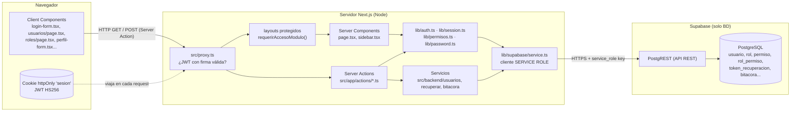
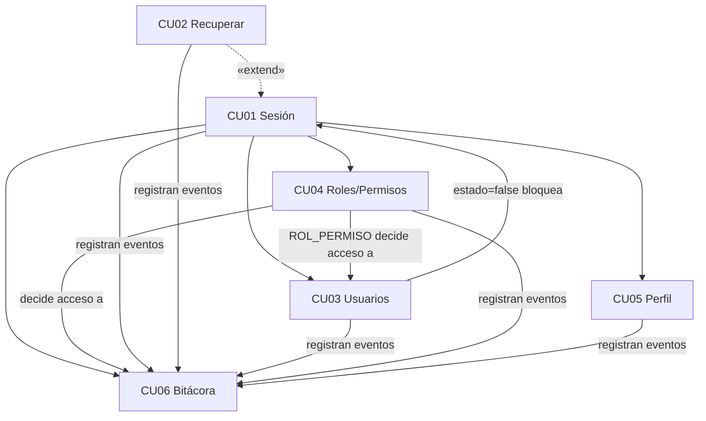

# 01 · Visión general de SMARTSERVICE

[← Volver al índice](README.md)

## 1. Problema y objetivo (según el PDF)

- **Empresa:** SgarNet, en Santa Cruz de la Sierra. Ofrece seguridad física y electrónica: CCTV analógico e IP, control de acceso y redes (PDF-P p.7–8).
- **Problema:** la información de clientes, cotizaciones, disponibilidad del personal técnico y mantenimientos **no está centralizada** (PDF-P p.11–15, sección 1.4). La formulación del problema está en PDF-P p.16.
- **Objetivo general:** «Desarrollar un sistema de información web para la gestión de recursos, ventas y mantenimientos de seguridad electrónica» (PDF-P p.16).
- **Objetivos específicos relevantes para el Ciclo 1:** usar Next.js, React, TypeScript, Tailwind y PostgreSQL en Supabase «para la autenticación y gestión de datos», y realizar «pruebas unitarias y de caja negra» (PDF-P p.17). Como se verá más abajo, **el código no usa Supabase para la autenticación y no tiene pruebas unitarias**.

**En palabras simples:** SmartService será el sistema interno de SgarNet. El Ciclo 1 construye la base que todo lo demás necesita: quién entra, qué puede ver cada rol y quién hizo qué.

## 2. Actores

| Actor (PDF-P p.98) | Rol en el Ciclo 1 | Cómo existe en el código |
|---|---|---|
| Administrador | Gestiona usuarios, roles y bitácora | Fila `ROL.id=1`, nombre `ADMINISTRADOR` (`seed.sql:26`) |
| Encargado | Operación comercial y caja | Rol `ENCARGADO` (id 2) |
| Personal Operativo / Técnico | Trabajo de campo | Rol `TECNICO` (id 3) |
| Proveedor (externo) | Fuera del Ciclo 1 | No es usuario del sistema |

El PDF modela a los tres actores internos como especializaciones de un actor genérico «Usuario» (PDF-P p.119).

## 3. Alcance del Ciclo 1

El PDF prioriza **CU01–CU06** para el Ciclo 1 (Tabla 2, PDF-P p.103) y los agrupa en el «Paquete 1: Seguridad y Gestión de Accesos» (PDF-P p.117).

| CU | Nombre | Estado en código | Detalle |
|---|---|---|---|
| CU01 | Gestionar Inicio y Cierre de Sesión | ✅ (con matices) | [02 → CU01](02-casos-de-uso.md#cu01--gestionar-inicio-y-cierre-de-sesión) |
| CU02 | Recuperar Contraseña | ⚠️ correo simulado | [02 → CU02](02-casos-de-uso.md#cu02--recuperar-contraseña) |
| CU03 | Administrar Usuarios | ✅ | [02 → CU03](02-casos-de-uso.md#cu03--administrar-usuarios) |
| CU04 | Configurar Roles y Asignar Permisos | ⚠️ sin «Nuevo Rol»; permisos solo por módulo | [02 → CU04](02-casos-de-uso.md#cu04--configurar-roles-y-asignar-permisos) |
| CU05 | Configurar Perfil Personal | ✅ (correo no editable) | [02 → CU05](02-casos-de-uso.md#cu05--configurar-perfil-personal) |
| CU06 | Gestionar Bitácora de Auditoría | ⚠️ sin vista de detalle ni IP | [02 → CU06](02-casos-de-uso.md#cu06--gestionar-bitácora-de-auditoría) |

## 4. Stack: documentado frente a encontrado

| Capa | PDF del proyecto (PDF-P p.45, p.65) | Apuntes | **Encontrado en el repositorio** | Evidencia |
|---|---|---|---|---|
| Framework | Next.js App Router | — | ✅ Next.js **16.3.6** | `package.json` |
| UI | React + TypeScript + Tailwind | HTML/CSS/JS | ✅ React 19.2.8, TypeScript 5 (`strict`), Tailwind 4 | `package.json`, `tsconfig.json` |
| Backend | Node.js + Server Actions | Marco teórico con **PHP 8 / Laravel 11** (PDF-A p.15) | ✅ Server Actions de Next.js. **No hay Laravel ni PHP.** | `src/app/actions/*.ts` |
| Base de datos | PostgreSQL en Supabase | PostgreSQL | ✅ PostgreSQL vía `@supabase/supabase-js` | `src/lib/supabase/service.ts` |
| Autenticación | **Supabase Auth** | Login con contraseña segura | ❌ Supabase Auth **no se usa**. ✅ Autenticación **propia**: bcryptjs + JWT (jose) | `src/lib/password.ts`, `src/lib/session.ts` |
| Seguridad en BD | RLS (RNF05, PDF-P p.25) | — | ❌ `schema.sql` no activa RLS | [05 → RLS](05-base-de-datos.md#4-rls-row-level-security) |
| Validación | — | — | ✅ Zod 4 | `src/backend/*/schema.ts` |
| Pagos / IA | Stripe / OpenAI (README) | Pasarela de pago | ⚠️ Dependencias instaladas y clientes creados, **nunca invocados** | `src/lib/stripe.ts`, `src/lib/openai.ts` |
| Despliegue | Vercel | «Nube recomendado» (PDF-A p.19) | ❔ Solo documentado: no hay `vercel.json` ni `.vercel/` | `README.md` |
| Pruebas | Unitarias y de caja negra (PDF-P p.17) | — | ❌ No existen | — |

## 5. Arquitectura real

El proyecto es un **monolito full-stack de Next.js** en cuatro capas:

1. **Proxy:** comprobación rápida de la cookie en `src/proxy.ts`.
2. **Páginas y componentes:** Server y Client Components.
3. **Server Actions:** `src/app/actions/`.
4. **Servicios de dominio:** `src/backend/<dominio>/`.

Todo acceso a datos usa **un único cliente Supabase con la *service role key***, solo en el servidor. **El navegador nunca habla directamente con Supabase.**



**Qué no aparece en el diagrama porque no existe:** Supabase Auth (`auth.users`), políticas RLS, Route Handlers (`route.ts`), un backend separado, Laravel ni un ORM.

## 6. Mapa de carpetas

```
SmartService/
├── schema.sql                     DDL: reset + 32 tablas + índices (sin RLS, triggers ni procedimientos)
├── seed.sql                       Datos iniciales: GRANT, roles, módulos, RBAC, 6 usuarios, bitácora
├── migracion_*.sql (4)            Cambios incrementales para una BD ya creada
├── auth_bridge.sql                LEGADO: Supabase Auth + RLS (modelo abandonado)
├── auth_local.sql                 Transición a autenticación propia
├── docs/fuentes/                  PDFs (fuera de git)
└── src/
    ├── proxy.ts                   Filtro de sesión en cada request
    ├── app/                       App Router: rutas y Server Actions
    │   ├── layout.tsx             Layout raíz → SidebarLayout
    │   ├── page.tsx               Dashboard "/"
    │   ├── login/                 CU01
    │   ├── recuperar/             CU02
    │   ├── usuarios/              CU03
    │   ├── roles/                 CU04
    │   ├── perfil/                CU05
    │   ├── bitacora/              CU06
    │   └── actions/               Server Actions ('use server')
    ├── backend/                   11 dominios: index, types, schema (Zod), service
    ├── components/                Sidebar, tarjetas, badges, íconos
    └── lib/                       auth, session, password, permisos, sesiones,
                                   bloqueo-cu01, navigation, supabase/, stripe, openai
```

Los dominios de `src/backend/` que **pertenecen al Ciclo 1** son `usuarios`, `recuperar` y `bitacora`. Los otros ocho son de ciclos futuros:

- `clientes`, `establecimientos`, `productos`, `proveedores`;
- `servicios`, `cotizaciones`, `ordenes`, `ventas`.

Esos ocho tienen servicios escritos, pero **ninguna página ni acción los usa**. La única excepción es `crearClienteAction` (`src/app/actions/clientes.ts:20`), que tampoco se invoca desde ninguna pantalla.

## 7. Módulos: terminados, parciales y ausentes

| Estado | Módulos |
|---|---|
| ✅ Terminados (Ciclo 1) | Login/logout con bloqueo, administración de usuarios, matriz rol → módulo, perfil y cambio de contraseña, listado y filtros de bitácora |
| ⚠️ Parciales | Recuperación (sin correo real), roles (sin crear rol y sin permisos por acción), bitácora (sin detalle ni IP), «Recordarme» (casilla sin efecto) |
| ❌ Ausentes (ciclos 2 y siguientes) | Clientes, cotizaciones y PDF, ventas/caja, jornadas y bloqueos de técnicos, órdenes, notas de servicio, proveedores y compras, kárdex, tickets, alertas, reportes, Stripe, OpenAI |

La navegación refleja esto en `src/lib/navigation.ts`:

- `P1` está habilitado.
- `P2` («Gestión de Personal Técnico») y `P3` («Clientes, Ventas y Cotizaciones») están `habilitado: false` y sin ítems (líneas 88–99).

## 8. Ejecución local y despliegue (solo lo que tiene evidencia)

- **Comandos** (`package.json`): `npm run dev`, `npm run build`, `npm start` y `npm run lint`. **No hay `npm test`.**
- **Requisitos del README:** Node ≥ 20.9.
- **Variables de entorno** (solo nombres, según `.env.example`):
  - `NEXT_PUBLIC_SUPABASE_URL`
  - `SUPABASE_SERVICE_ROLE_KEY`
  - `AUTH_SECRET`
  - `STRIPE_SECRET_KEY`
  - `STRIPE_WEBHOOK_SECRET`
  - `OPENAI_API_KEY`
- **Base de datos:** según el README, se ejecuta `schema.sql` y luego `seed.sql` en el SQL Editor de Supabase. ⚠️ Con el `schema.sql` actual, **`seed.sql` fallaría**; ver [05 → contradicción](05-base-de-datos.md#6-hallazgo-crítico-schemasql-y-seedsql-no-son-compatibles).
- **Despliegue en Vercel:** ❔ NO VERIFICABLE. Solo aparece en el README.

## 9. Límites del sistema (PDF-P p.23)

Quedan fuera del alcance:

- portal de clientes;
- facturación electrónica con el SIN;
- aplicación móvil nativa;
- video y telemetría en vivo.

El código es coherente con esto: no hay nada de eso.

## 10. Dependencias entre los seis CU



| Relación | Cómo se implementa realmente |
|---|---|
| CU01 como precondición de todos | `src/proxy.ts` y `getCurrentUser()` en `src/lib/auth.ts:16` |
| CU02 «extend» CU01 | Enlace «¿Olvidaste tu contraseña?» en `src/app/login/login-form.tsx:171-176` |
| CU05 «include» CU02 (según PDF-P p.118) | ⚠️ **No se reutiliza código de CU02.** CU05 tiene su propio `cambiarContrasena` (`src/backend/usuarios/service.ts:215`). Solo comparten la regla `contrasenaSchema`. |
| CU04 controla CU03 y CU06 | `requerirAccesoModulo('/usuarios')` y `requerirAccesoModulo('/bitacora')` leen `rol_permiso` |
| CU03 afecta CU01 | Un usuario con `estado=false` no puede iniciar sesión (`auth.ts:119`) y pierde su sesión activa (`lib/auth.ts:28`) |
| Todos alimentan CU06 | `registrarEvento` / `registrarBitacora` (`src/backend/bitacora/service.ts:16,41`) |
