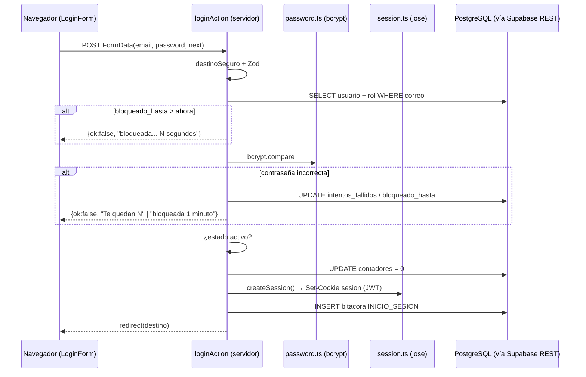

# 03 · Backend en profundidad: qué ocurre en el servidor

[← Índice](README.md) · Relacionados: [02 CU](02-casos-de-uso.md) · [04 Frontend](04-frontend-profundo.md) · [05 BD](05-base-de-datos.md) · [06 Seguridad](06-seguridad.md)

## 1. ¿Qué tipo de backend tiene SmartService? (comprobado)

| Mecanismo | ¿Existe? | Evidencia |
|---|---|---|
| **Server Actions** (`'use server'`) | ✅ Es el mecanismo principal | 7 archivos en `src/app/actions/` |
| **Server Components** que consultan datos | ✅ | `src/app/page.tsx`, `src/app/perfil/page.tsx`, `src/app/bitacora/page.tsx`, `src/app/recuperar/page.tsx`, `src/components/sidebar.tsx` |
| **Proxy** (el antiguo middleware) | ✅ | `src/proxy.ts` |
| **Route Handlers** (`route.ts`, API REST propia) | ❌ | No existe `src/app/api/` ni ningún `route.ts` |
| API externa propia / backend separado / Laravel | ❌ | No existe |
| Llamadas directas del navegador a Supabase | ❌ | No existe un cliente con la anon key. `getSupabaseServiceClient` solo se importa en código de servidor |
| Capa de servicios por dominio | ✅ | `src/backend/<dominio>/service.ts` |
| Supabase Auth | ❌ | Ningún `supabase.auth.*` en `src/` |
| ORM (Prisma, Drizzle…) | ❌ | Se usa `supabase-js` (PostgREST) |

**En palabras simples:** no hay una «API» como en Laravel. Cuando un formulario se envía, React llama a una **función del servidor** (Server Action) que Next.js expone como un POST especial. Esa función comprueba la sesión y los permisos, valida los datos y consulta PostgreSQL a través de Supabase.

**Dato técnico:** cada función exportada de un archivo `'use server'` se convierte en un *endpoint* invocable por POST, con un identificador que genera Next.js. Por eso **cada acción debe comprobar por sí misma la sesión y el permiso**: el hecho de que el botón esté oculto no protege nada. SmartService lo hace en casi todas las acciones (ver la tabla del apartado 4).

### Tres niveles de control: quién garantiza qué

| Control | Aplicación (Next/Node) | Supabase Auth | PostgreSQL / RLS |
|---|---|---|---|
| ¿Quién es el usuario? | ✅ JWT propio (`src/lib/session.ts`) + relectura en BD (`src/lib/auth.ts`) | ❌ no se usa | ❌ |
| ¿Qué módulos puede usar? | ✅ `src/lib/permisos.ts` lee `rol_permiso` | ❌ | ❌ No hay RLS |
| Formato de los datos | ✅ Zod | ❌ | ✅ Parcial: `NOT NULL`, `UNIQUE`, FK y `CHECK` en `schema.sql` |
| Contraseña segura / hash | ✅ `src/lib/password.ts` | ❌ | ❌ La BD solo guarda el texto del hash |
| ¿Quién puede consultar la BD por la API REST? | La **service role key** solo vive en el servidor | — | `GRANT` a `service_role` (`seed.sql:19-21`). ❔ Los grants del rol `anon` en el proyecto remoto NO son verificables |

## 2. Variables de entorno (solo nombres)

| Variable | Dónde se lee | Para qué |
|---|---|---|
| `NEXT_PUBLIC_SUPABASE_URL` | `src/lib/supabase/service.ts:15` | URL del proyecto Supabase |
| `SUPABASE_SERVICE_ROLE_KEY` | `src/lib/supabase/service.ts:16` | Clave privilegiada que salta RLS. Solo en el servidor |
| `AUTH_SECRET` | `src/lib/session.ts:19`, `src/proxy.ts:12` | Firma y verificación HS256 del JWT de sesión |
| `STRIPE_SECRET_KEY`, `STRIPE_WEBHOOK_SECRET` | `src/lib/stripe.ts` (solo la primera) | Sin uso en el Ciclo 1 |
| `OPENAI_API_KEY` | `src/lib/openai.ts` | Sin uso en el Ciclo 1 |

⚠️ `NEXT_PUBLIC_*` se incrusta en el bundle del navegador. Aquí solo es la URL, que no es un secreto. La `SUPABASE_SERVICE_ROLE_KEY` **no** lleva el prefijo, así que no se expone.

## 3. Flujos trazados

### 3.1 Login completo paso a paso

| # | Paso | Ruta y símbolo | Capa |
|---|---|---|---|
| 1 | El usuario abre `/login` | `src/proxy.ts:22` `proxy()` → ruta pública (`RUTAS_PUBLICAS`, L9) | Proxy |
| 2 | Se sanea `?next=` | `src/app/login/page.tsx:14` | Server Component |
| 3 | Se renderiza el formulario | `src/app/login/login-form.tsx:18` `LoginForm` | Client Component |
| 4 | Validación visual (`type=email`, `required`) | `login-form.tsx:89-127` | Navegador (saltable) |
| 5 | POST de la Server Action | `useActionState(loginAction)` (`login-form.tsx:19`) | Red |
| 6 | Destino seguro | `destinoSeguro` (`src/app/actions/auth.ts:40`) | Servidor |
| 7 | Zod: formato de correo y contraseña no vacía | `loginSchema` (`auth.ts:13`), uso en L62-65 | Servidor |
| 8 | `SELECT` de usuario y rol por correo | `auth.ts:67-72` | Supabase / PostgreSQL |
| 9 | ¿El correo existe? | `auth.ts:76` | Servidor |
| 10 | ¿Hay un bloqueo vigente? | `auth.ts:83-94` | Servidor + BD |
| 11 | Comparación bcrypt | `verificarContrasena` (`src/lib/password.ts:33`), llamada en `auth.ts:96` | Servidor |
| 12 | Si falla: contador y bloqueo | `auth.ts:99-117` + `actContadores` (L28-38) | Servidor + `UPDATE` |
| 13 | ¿Usuario activo? | `auth.ts:119` | Servidor |
| 14 | Supabase Auth | **NO EXISTE** | — |
| 15 | Comprobar permisos al entrar | **NO EXISTE** en el login. Se comprueba después, en cada ruta | — |
| 16 | Reinicio de contadores | `auth.ts:124` | `UPDATE` |
| 17 | Creación de la sesión (JWT y cookie) | `createSession` (`src/lib/session.ts:27-43`) | Servidor → cookie |
| 18 | Bitácora | `registrarEvento` (`src/backend/bitacora/service.ts:41`) | `INSERT` |
| 19 | Redirección | `redirect(destino)` (`auth.ts:156`) | Respuesta |
| 20 | Siguiente petición | `proxy()` verifica la firma; el layout y las páginas llaman a `getCurrentUser()` | Proxy + servidor |



### 3.2 Logout
`logoutAction` (`src/app/actions/auth.ts:162-181`):
1. `getCurrentUser()`.
2. `INSERT` en `bitacora` con `CIERRE_SESION` (dentro de `try`).
3. `destroySession()` (`src/lib/session.ts:67`) hace `cookies().delete('sesion')`.
4. `revalidatePath` y `redirect('/login')`.

No hay lista negra de tokens: el JWT eliminado del navegador **no se invalida en el servidor**.

### 3.3 Recuperación
Ver [02 → CU02](02-casos-de-uso.md#cu02--recuperar-contraseña) para el paso a paso. En el servidor intervienen:
- `src/app/actions/recuperar.ts`;
- `src/backend/recuperar/service.ts`, clase `ControlRecuperarContrasena`;
- `src/lib/sesiones.ts`, clase `GestorSesiones`;
- `src/lib/password.ts` y `src/backend/bitacora/service.ts`.

### 3.4 Administración de usuarios, roles, perfil y bitácora
Todos siguen el mismo patrón:

```
Server Action → [tienePermisoModulo(ruta)] → requireUser() → Zod → service.ts → Supabase → registrarBitacora/registrarEvento
```

## 4. Tabla maestra de funciones de servidor

| Ruta exacta | Exportación / función y líneas | Quién la llama | Entrada | Validación | Operación | Salida / error | CU | Pregunta probable |
|---|---|---|---|---|---|---|---|---|
| `src/proxy.ts` | `proxy` L22-49 | Next.js, en cada request que coincide con `matcher` (L51-55) | `NextRequest` con cookie | Firma JWT y `uid` numérico | Ninguna en BD | `redirect('/login?next=')` o `next()` | Todos | ¿Qué protege el proxy y qué no? |
| `src/lib/session.ts` | `createSession` L27-43 | `loginAction`, `actualizarPerfilAction` | `SesionUsuario` | — | Firma HS256, 7 días | Cookie httpOnly | CU01, CU05 | ¿Dónde vive la sesión? |
| `src/lib/session.ts` | `getSession` L45-65 | `getCurrentUser` | Cookie | `jwtVerify` | — | `SesionUsuario \| null` | Todos | ¿Qué pasa si modifico el JWT? |
| `src/lib/session.ts` | `destroySession` L67-69 | `logoutAction` | — | — | Borra la cookie | — | CU01 | ¿El logout invalida el token? |
| `src/lib/auth.ts` | `getCurrentUser` L16-32 (`cache`) | Páginas, layouts, acciones, `permisos.ts` | — | Estado activo y `version_sesion` | `SELECT usuario + rol` | `UsuarioConRol \| null` | Todos | ¿Por qué se relee el usuario si ya hay JWT? |
| `src/lib/auth.ts` | `requireUser` L34-39 | Acciones y servicios | — | — | — | Usuario, o `Error('No autorizado…')` | Todos | ¿Diferencia con `getCurrentUser`? |
| `src/lib/password.ts` | `contrasenaSchema` L11-25 | Esquemas de usuarios y recuperar | string | 8–72 caracteres, mayúscula, minúscula, dígito, especial, ≤72 bytes | — | ZodError | CU02, CU03, CU05 | ¿Dónde se exige la política? |
| `src/lib/password.ts` | `hashContrasena` L28, `verificarContrasena` L33 | Servicios y login | texto | — | bcrypt costo 10 | hash / boolean | CU01–03, CU05 | ¿Por qué bcrypt y no SHA-256? |
| `src/lib/permisos.ts` | `getPermisosDeRol` L44-60 (`cache`) | Sidebar, dashboard, `tienePermisoModulo` | `rolId` | — | `SELECT rol_permiso ⋈ permiso` | `string[]` (vacío si hay error) | CU04 | ¿Qué es *fail-closed*? |
| `src/lib/permisos.ts` | `tienePermisoModulo` L76-86 | Acciones de usuarios, roles y bitácora | ruta | La ruta debe estar en `MODULOS` | — | boolean | CU03, CU04, CU06 | ¿Qué pasa con una ruta no registrada? (devuelve `true`, L81) |
| `src/lib/permisos.ts` | `requerirAccesoModulo` L93-99 | `usuarios/`, `roles/`, `bitacora/layout.tsx` | ruta | Sesión y permiso | — | `redirect('/login')` o `redirect('/?aviso=sin_permiso')` | CU03, CU04, CU06 | ¿Cómo evitan la URL directa? |
| `src/lib/sesiones.ts` | `GestorSesiones.invalidarSesiones` L13-31 | `restablecerContrasena` | `usuarioId` | — | `version_sesion + 1` | Error si falla | CU02 | ¿Cómo invalidan un JWT *stateless*? |
| `src/lib/supabase/service.ts` | `getSupabaseServiceClient` L12-30 | Toda la capa de datos | — | Existencia de las variables de entorno | Singleton `createClient` con la service role | Cliente | Todos | ¿Por qué service role? ¿Y RLS? |
| `src/app/actions/auth.ts` | `loginAction` L54-160 | `LoginForm` | FormData | Zod + reglas de CU01 | `SELECT/UPDATE usuario`, `INSERT bitacora` | Estado `{ok,error}` o redirección | CU01 | Recorrido completo del login |
| `src/app/actions/auth.ts` | `logoutAction` L162-181 | Sidebar | — | — | `INSERT bitacora`, borrar cookie | Redirección a `/login` | CU01 | — |
| `src/app/actions/recuperar.ts` | `solicitarRecuperacionAction` L32-50 | `FormularioEmail` | FormData(`correo`) | Zod en el servicio | `INSERT token_recuperacion` y `bitacora` | `{ok, correo, enlace}` | CU02 | ¿Por qué se devuelve el enlace? |
| `src/app/actions/recuperar.ts` | `restablecerContrasenaAction` L56-77 | `FormularioNuevaContrasena` | FormData(`token`, `contrasena`, `confirmacion`) | Zod + token | `UPDATE usuario/token`, `INSERT bitacora` | `{ok,error}` | CU02 | ¿Cómo se evita reutilizar el enlace? |
| `src/backend/recuperar/service.ts` | `ControlRecuperarContrasena.solicitarRecuperacion` L43-79, `verificarEnlace` L86-101, `restablecerContrasena` L109-142 | Acciones y `recuperar/page.tsx` | correo / token | Zod, existencia, `usado`, vencimiento | ver CU02 | Excepciones con mensajes del PDF | CU02 | ¿Qué se guarda del token? |
| `src/app/actions/usuarios.ts` | `listarUsuarios` L85, `obtenerRolesActivos` L93 | `usuarios/page.tsx` | — | `exigirAccesoUsuarios` (L47) | `SELECT` | Entidades **sin hash** | CU03 | ¿Se envía el hash al navegador? No (`usuarioAEntidad`, L55) |
| `src/app/actions/usuarios.ts` | `registrarUsuario` L110-146 | Modal «Guardar» | 5 argumentos | Permiso + Zod `crearUsuarioSchema` | `INSERT usuario`, `INSERT bitacora` | `RespuestaAccion` | CU03 | ¿Dónde se aplica el hash al crear? (`service.ts:175`) |
| `src/app/actions/usuarios.ts` | `actualizarUsuario` L148-179 | Modal «Guardar» (edición) | id + datos | Permiso, no cambiar el propio rol (L156), Zod | `UPDATE usuario`, `INSERT bitacora` | idem | CU03 | ¿Qué impide que un admin se quite el rol? |
| `src/app/actions/usuarios.ts` | `cambiarEstadoCuenta` L181-233 | Interruptor | id + estado | Permiso, no ADMINISTRADOR (L199), no uno mismo (L206) | `UPDATE estado`, `INSERT bitacora` | idem | CU03 | ¿Qué pasa con la sesión del desactivado? |
| `src/app/actions/roles.ts` | `fetchRolesYPermisos` L52-101 | `roles/page.tsx` | — | Permiso `/roles` | 3 `SELECT` | roles, módulos, asignación y `esSesionAdministrador` | CU04 | — |
| `src/app/actions/roles.ts` | `guardarPermisosRol` L104-179 | «Guardar Cambios» | rolId, nombres[] | Permiso, rol existe, regla ADMINISTRADOR (L128), permisos existen | `DELETE` + `INSERT rol_permiso`, `INSERT bitacora`, `revalidatePath` | `RespuestaAccionRoles` | CU04 | ¿Es atómico? (No) |
| `src/app/actions/perfil.ts` | `actualizarPerfilAction` L34-68 | `PerfilForm` | FormData(`nombre`, `telefono`) | `requireUser` + Zod | `UPDATE usuario`, `INSERT bitacora`, nueva cookie | `{ok,error}` | CU05 | ¿Puede cambiar el rol desde aquí? No |
| `src/app/actions/perfil.ts` | `cambiarContrasenaAction` L75-95 | `PerfilForm` | FormData(3 campos) | `requireUser` + Zod + bcrypt de la actual | `UPDATE contrasena`, `INSERT bitacora` | `{ok,error}` | CU05 | ¿Por qué se pide la contraseña actual? |
| `src/backend/usuarios/service.ts` | `getPerfil` L105, `actualizarPerfil` L122, `crearUsuario` L173, `actualizarUsuario` L190, `cambiarContrasena` L215 | Acciones y `perfil/page.tsx` | ver arriba | Zod | Supabase | Excepciones | CU03, CU05 | — |
| `src/app/actions/bitacora.ts` | `listarBitacoraAction` L11-20 | `bitacora/page.tsx` (Server Component) | filtros | Permiso `/bitacora` + Zod | `SELECT bitacora` | `Bitacora[]` | CU06 | ¿Cómo filtran? |
| `src/backend/bitacora/service.ts` | `registrarBitacora` L16, `registrarEvento` L41, `listarBitacora` L52, `getEventoPorId` L67 | Todos los CU | evento / filtros | Zod | `INSERT` / `SELECT` | Fila o Error | CU06 | ¿La bitácora es inmutable? |
| `src/app/actions/clientes.ts` | `crearClienteAction` L20-40 | **Nadie** (sin pantalla) | datos de cliente | `requireUser` + Zod. ⚠️ **sin comprobar permiso de módulo** | `INSERT cliente` | `{id}` | (CU07, fuera del Ciclo 1) | — |

## 5. Archivos esenciales: por qué existen, cuándo se ejecutan y qué responder

### 5.1 `src/proxy.ts`
- **Por qué existe:** en Next.js 16, `middleware.ts` pasó a llamarse **proxy** (el comentario de L17-21 lo confirma). Es un filtro barato antes de renderizar.
- **Cuándo se ejecuta:** en cada request, salvo los archivos estáticos (`matcher`, L51-55).
- **Qué hace:**
  - `getSecret()` (L11) prepara la clave.
  - `proxy()` verifica el JWT con `jwtVerify`, comprueba `payload.uid` (L30) y redirige a `/login?next=` si la sesión no es válida y la ruta no es pública (L38-42).
  - Si ya hay sesión y se visita `/login`, envía a `/` (L44-46).
- **No hace:** no consulta la BD, no conoce permisos y no sabe si el usuario fue desactivado. Eso lo resuelven `getCurrentUser` y `requerirAccesoModulo`.

```ts
// src/proxy.ts:38-42
if (!sesionValida && !esPublica) {
  const url = new URL('/login', request.url)
  url.searchParams.set('next', pathname)
  return NextResponse.redirect(url)
}
```

> **Pregunta:** «Si borro el proxy, ¿el sistema queda abierto?»
> **Respuesta corta:** No del todo. Las páginas protegidas y las acciones vuelven a comprobar la sesión y el permiso en el servidor.
> **Respuesta técnica:** Los layouts llaman a `requerirAccesoModulo`, que usa `getCurrentUser`, y las acciones llaman a `requireUser` y `tienePermisoModulo`. Sin el proxy, una página como `/` mostraría el contenido vacío sin redirigir, y `/perfil` lanzaría un error, pero ningún dato protegido saldría del servidor.

### 5.2 `src/lib/session.ts`
- **Por qué existe:** implementa una sesión **propia** sin Supabase Auth.
- **Cuándo se ejecuta:** en el login, al actualizar el perfil (se renueva el nombre) y en cada lectura de sesión.
- **Métodos:**
  - `createSession`: JWT HS256 con `{uid, nombre, correo, rol_id, rol, version}`, `setExpirationTime('7d')`; cookie `httpOnly`, `secure` en producción, `sameSite='lax'` y `maxAge` de 7 días (L27-43).
  - `getSession`: verifica y reconstruye el objeto (L45-65).
  - `destroySession`: elimina la cookie (L67-69).

```ts
// src/lib/session.ts:35-41
cookieStore.set(COOKIE_NAME, token, {
  httpOnly: true,
  secure: process.env.NODE_ENV === 'production',
  sameSite: 'lax',
  path: '/',
  maxAge: MAX_AGE_SECONDS,
})
```

> **Pregunta:** «¿Qué pasa si alguien cambia su `rol_id` dentro del JWT desde el navegador?»
> **Respuesta corta:** La firma deja de ser válida y se rechaza.
> **Respuesta técnica:** `jwtVerify` con `AUTH_SECRET` (HS256) falla si el payload cambia. Además, `getCurrentUser` **no confía en el rol del JWT**: vuelve a leer `usuario.rol_id` de la BD (`src/lib/auth.ts:20-24`), y los permisos se calculan con ese `rol_id`.

### 5.3 `src/lib/auth.ts`
- **Por qué existe:** es la fuente única de «quién es el usuario actual», validado contra la BD.
- **Cuándo se ejecuta:** en cada render o acción que lo invoca. `cache()` de React lo memoiza **por request** (L10-16).
- **Reglas:**
  - rechaza si la fila no existe;
  - rechaza si `estado` es false (L28);
  - rechaza si `sesion.version !== data.version_sesion` (L30).

> **Pregunta:** «¿Cómo desactivan la sesión de un usuario ya logueado?»
> **Respuesta corta:** En cada petición se relee su estado en la BD; si está inactivo, deja de tener sesión.
> **Respuesta técnica:** `getCurrentUser` devuelve `null` si `estado=false` (`auth.ts:28`). Para la recuperación de contraseña se incrementa `version_sesion` (`sesiones.ts:26`) y los JWT con la versión anterior se rechazan (`auth.ts:30`).

### 5.4 `src/lib/permisos.ts`
- **Por qué existe:** implementa RBAC por módulo leyendo la BD, sin codificar roles.
- **Cuándo se ejecuta:** en el Sidebar, el dashboard, los layouts protegidos y las acciones.
- **Métodos:**
  - `MODULOS` (L28-37): catálogo de 8 rutas.
  - `moduloPorRuta` (L39).
  - `getPermisosDeRol` (L44-60): es *fail-closed*; si hay error devuelve `[]` (L52-55).
  - `getModulosPermitidos` (L63): **sin uso actual**.
  - `tienePermisoModulo` (L76-86): una ruta que no está en `MODULOS` devuelve `true` (L81).
  - `requerirAccesoModulo` (L93-99).

```ts
// src/lib/permisos.ts:76-86 (resumen)
const modulo = moduloPorRuta(ruta)
if (!modulo) return true // Ruta no registrada en el catálogo: no aplica RBAC.
const claves = await getPermisosDeRol(usuario.rol_id)
return claves.includes(modulo.clave)
```

> **Pregunta:** «¿Dónde está definido que el técnico no ve Usuarios?»
> **Respuesta corta:** En la base de datos, en la tabla `rol_permiso`, no en el código.
> **Respuesta técnica:** `seed.sql:146-148` asigna al rol 3 solo `PERFIL`, `COTIZACIONES` y `ORDENES_TRABAJO`. `getPermisosDeRol` lo lee y `requerirAccesoModulo('/usuarios')` redirige a quien no tiene `USUARIOS`.

⚠️ **Dos fuentes de verdad:** `MODULOS` (`permisos.ts`) y `PAQUETES` (`src/lib/navigation.ts`) deben coincidir en claves y rutas.

### 5.5 `src/lib/password.ts`
- **Por qué existe:** centraliza la política de contraseñas y el hash.
- **Contenido:**
  - `COSTO_BCRYPT = 10` (L5).
  - `contrasenaSchema` (L11-25): mínimo 8 (L13), máximo 72 (L14), `[A-Z]` (L15), `[a-z]` (L16), `\d` (L17), carácter especial `[^A-Za-z0-9]` (L19), ≤72 bytes (L24).
  - `hashContrasena` (L28) y `verificarContrasena` (L33).

> **Pregunta:** «¿Por qué máximo 72 caracteres?»
> **Respuesta corta:** Porque bcrypt solo usa los primeros 72 bytes.
> **Respuesta técnica:** Una contraseña más larga se truncaría en silencio. Por eso se valida también por bytes (`Buffer.byteLength`, L23-24), ya que las tildes ocupan 2 bytes en UTF-8.

### 5.6 `src/lib/supabase/service.ts`
- **Por qué existe:** es el único punto de conexión con la BD. Es un singleton perezoso (L4, L12-30).
- **Clave de uso:** usa la **service role**, que **se salta RLS** (comentario L7-11). Configura `persistSession:false` porque no usa Auth.
- **Contradicción interna:** el comentario dice «NUNCA en Server Actions que reciban input del cliente directamente», pero **todas** las Server Actions lo usan. Defiéndelo así: la validación (Zod) y la autorización (sesión + RBAC) se hacen **antes**, en la aplicación.

> **Pregunta:** «Si usan service role, ¿qué impide que un usuario lea todas las tablas?»
> **Respuesta corta:** La clave nunca llega al navegador, y cada acción filtra por sesión y permiso antes de consultar.
> **Respuesta técnica:** El navegador no tiene cliente Supabase; solo invoca Server Actions. La autorización es **de aplicación**, no de la BD. La RLS no actúa como segunda defensa (ver [06](06-seguridad.md#6-rls-y-la-service-role)).

### 5.7 `src/app/actions/auth.ts`
Recorrido completo en [3.1](#31-login-completo-paso-a-paso).
- `actContadores` (L28-38) no lanza errores (solo `console.warn`), para que el login funcione aunque la migración de CU01 no esté aplicada.
- `destinoSeguro` (L40-42).

> **Pregunta:** «¿Qué valida primero, la contraseña o el estado?»
> **Respuesta corta:** Primero el bloqueo, luego la contraseña y luego el estado activo.
> **Respuesta técnica:** L83 (bloqueo) → L96 (bcrypt) → L119 (estado). Consecuencia: un usuario inactivo que falla la contraseña también acumula intentos, y el mensaje de la contraseña revela que la cuenta existe.

### 5.8 `src/app/actions/usuarios.ts`
- **Guardia común:** `exigirAccesoUsuarios` (L47-52).
- **Utilidades:**
  - `usuarioAEntidad` (L55-66) oculta el hash.
  - `registrarAuditoria` (L69-75) nunca interrumpe la operación.
  - `mensajeDeError` (L78-83) devuelve el primer mensaje de Zod o el `message` del error, incluidos **mensajes técnicos de la BD**.

> **Pregunta:** «¿Qué impide que desde DevTools alguien llame a `cambiarEstadoCuenta` para desactivar al admin?»
> **Respuesta corta:** La propia acción, en el servidor.
> **Respuesta técnica:** `cambiarEstadoCuenta` exige el permiso `USUARIOS` en `rol_permiso` (L186), consulta el rol del objetivo en la BD y rechaza si es `ADMINISTRADOR` (L199) o si es uno mismo (L206).

### 5.9 `src/app/actions/roles.ts`
- **Métodos:** `rolAEntidad` (L37) asigna color y letra; `fetchRolesYPermisos`; `guardarPermisosRol`.
- **Regla fija por nombre:** `rol.nombre === "ADMINISTRADOR"` (L128). Es la única regla atada a un nombre de rol, junto con la de `usuarios.ts:199`.

> **Pregunta:** «¿Qué pasa si falla el `INSERT` después del `DELETE`?»
> **Respuesta corta:** El rol quedaría sin permisos; no es una transacción.
> **Respuesta técnica:** Son dos llamadas REST independientes (L151 y L155). 💡 PROPUESTA — NO IMPLEMENTADO: mover la operación a una función SQL (`rpc`) con `BEGIN/COMMIT`, o hacer un *upsert* y luego borrar solo las filas sobrantes.

### 5.10 `src/app/actions/recuperar.ts` y `src/backend/recuperar/service.ts`
- `hashToken` (L17) usa SHA-256.
- `crearTokenSeguro` (L21) usa 32 bytes aleatorios de `crypto`.
- `enviarCorreoRecuperacion` (L26) solo hace `console.log`.

> **Pregunta:** «Si alguien roba la base de datos, ¿puede usar los tokens?»
> **Respuesta corta:** No, solo se guarda su hash.
> **Respuesta técnica:** `token_recuperacion.hash_token` contiene el SHA-256 (`service.ts:63`). El token en claro solo existe en el enlace. Un token de 256 bits aleatorios no se puede revertir por fuerza bruta.

### 5.11 `src/app/actions/perfil.ts`
Renueva la cookie tras actualizar el perfil (L50-57), para que el JWT refleje el nombre nuevo. El nombre que se muestra, sin embargo, sale de la BD vía `getCurrentUser`.

### 5.12 `src/backend/bitacora/service.ts`
- `registrarBitacora` y `registrarEvento` hacen lo mismo con esquemas casi iguales. La diferencia es que el primero limita la `descripcion` a 1000 caracteres (`schema.ts:10`). Hay duplicación.
- `listarBitacora` aplica filtros opcionales.

## 6. Manejo de errores (patrón real)

| Patrón | Dónde | Consecuencia |
|---|---|---|
| Devolver `{ok:false, error}` en lugar de lanzar | Acciones con `useActionState` (auth, recuperar, perfil) | El formulario muestra el mensaje |
| `RespuestaAccion {ok, mensaje}` | usuarios, roles | La página muestra el mensaje |
| `throw` | `listarUsuarios`, `fetchRolesYPermisos`, `listarBitacoraAction` | La página captura (`catch`) y muestra un error genérico |
| Bitácora «no bloqueante» | login, logout, usuarios | `try/catch` + `console.error` |
| Bitácora «bloqueante» | perfil, recuperar, roles | Si falla, el usuario ve un error **aunque el cambio ya se guardó** |
| Mensajes técnicos al usuario | `mensajeDeError`, `errorVisible`, `No se pudo…: ${error.message}` | Pueden exponer detalles de PostgreSQL |

## 7. ¿Cómo se impide saltar el frontend?

1. **Sesión:** cada acción protegida llama a `requireUser()` o a `tienePermisoModulo()`, que a su vez usa `getCurrentUser()`.
2. **Permiso:** cada acción de usuarios, roles y bitácora comprueba el módulo en `rol_permiso`.
3. **Datos:** Zod en el servidor repite, y amplía, la validación HTML.
4. **Reglas de negocio en el servidor:** no desactivar al administrador, no cambiar el propio rol, contraseña actual, token vigente.
5. **Límites:**
   - `crearClienteAction` no comprueba el permiso de módulo.
   - `/perfil` no comprueba el permiso `PERFIL`.
   - No hay límite de peticiones (*rate limiting*) aparte del bloqueo por cuenta del CU01.
   - El contador de intentos se lee y luego se escribe (L96-116). Peticiones simultáneas podrían superar los 3 intentos antes del bloqueo (condición de carrera).
